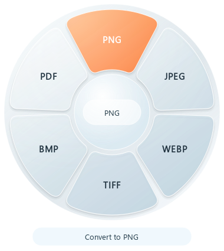
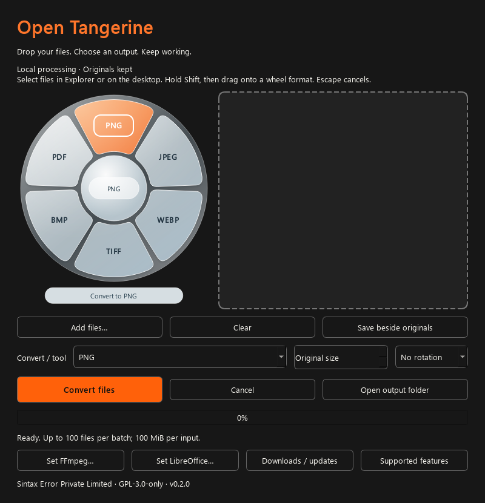

# Open Tangerine — Windows and Linux trial 0.2.0

This is an early cross-platform desktop edition, not a port of every Mac feature.
No account, telemetry, uploads, administrator service or automatic downloads.

## Install

- **Windows 10/11 x64:** extract the entire Windows ZIP into a local folder. Run `OpenTangerine.exe` inside it. Keep `_internal` alongside it. This trial is unsigned; Windows may warn about an unknown publisher. Do not disable Defender or SmartScreen globally. Do not run a file flagged as malware; report the exact warning.
- **Linux x64:** Ubuntu 24.04 or a compatible glibc 2.39+ desktop. Extract the `.tar.gz`, then run `OpenTangerine`. X11 or Wayland desktop libraries are required. Other distributions and ARM are unverified. No root installation is needed.
- Keep this folder to uninstall/remove it later. Updating: quit the app, extract the new package into a separate folder and launch it. Keep the old folder if you want rollback.
- Check the asset's SHA-256 against its companion `.sha256` file. This detects corruption; it is not a publisher signature.

## Use

Drop local files **into the app window**, or click Add files. Choose an output/tool and Convert files. Multiple files are processed sequentially; a failure does not stop later files. Outputs go beside originals, or into your selected folder. Existing files are never replaced. Completed outputs remain if a batch is cancelled. Per-file rows show failures.

The in-window glass wheel offers six image outputs and stays in sync with the full output/tool selector. Its buttons support keyboard focus and accessible names, and are disabled during conversion. Rounded frosted segments, a luminous rim, an orange selection, a center label and a conversion caption share the same design as the floating wheel. The Qt material uses translucent gradients; it does not use SwiftUI `glassEffect`, native desktop blur or screen capture.

### Windows system-wide Shift wheel (source builds)

Keep the app running, including minimized. Select 1–100 local files in File Explorer or on the desktop, place the pointer over the selected file, and hold **Shift**. A floating glass ring appears around the pointer after Windows reads the selection. Drag the files through the open center onto a format segment, then release the mouse to convert. The highlighted segment is the output. Holding Shift alone never starts conversion. Release Shift before dragging, drop outside the ring, or press **Escape** to cancel. You can release Shift after starting the drag; the ring remains until the drag ends.

Image selections offer PNG, JPEG, WebP, TIFF, BMP and PDF. PDFs offer text extraction, splitting and merging (multiple PDFs). Spreadsheets, documents and subtitles offer the matching routes listed below. Media formats appear when FFmpeg is configured or found on PATH; selections containing audio offer audio outputs. A setup hint appears for media or legacy Office files that need an optional converter. Mixed incompatible inputs and unsupported files show no conversion choices. File contents are validated by the worker, so corrupt or unsupported codecs can still fail. The center label and caption are input-transparent, keeping the source file reachable for dragging.

Other applications can supply local file drops by starting a drag and holding Shift; the ring learns the formats when files enter it. Selection-only discovery is limited to Explorer and the Windows desktop. The wheel requests a copy drop so originals stay in place, then uses the app's output folder, image options, batch limits, cancellation and error reporting. It does not convert on a mouse release outside a valid drop.

Disable **Enable system-wide Shift wheel** in the app to stop the trigger. Use **Quit** in the tray to stop the application; there is no background startup service. It polls modifier/mouse state, reads Shell selection only on a Shift press, and uses a short-lived Windows PowerShell Shell COM reader. It does not record typing, change the clipboard or capture the screen. Managed systems that block PowerShell/Shell automation can still use the in-window wheel. Linux does not have the global trigger.

### Windows background mode

Drop files onto a floating wheel segment to convert immediately to that format. The wheel disappears and conversion runs without opening or focusing the main window. Outputs use the current output folder, or are saved beside originals by default. Tray notifications report completion or errors; **Open output folder** and **Open Open Tangerine** in the tray provide results and detailed per-file status.

Click **Run in background** or close the main window to keep the app and Shift wheel running in the system tray. Closing the window during conversion lets the batch finish. Double-click the tray icon to reopen the window. The tray menu also offers Shift wheel enable/disable, cancellation, and **Quit**. Quit cancels active work and waits for the worker to stop before exiting; completed outputs are retained.

**Windows starts in background mode by default.** Run `OpenTangerine.exe` or, from source at the repository root, `pythonw Desktop/app.py`. Use `--window` to open the main window at startup. `--background` and `--headless` remain aliases for explicitly requesting background mode. The tray and on-demand wheel require a logged-in Windows desktop session; this is not a Windows service or display-free server mode. If a tray is unavailable, default startup falls back to a visible window; an explicit background request fails instead of leaving an inaccessible process. Linux continues to start with a window.





Images: PNG, JPEG, WebP, TIFF and BMP output; PNG/JPEG/WebP/TIFF/BMP/AVIF input. JPEG transparency is flattened against white. Optional maximum-side resizing and clockwise rotation. Animated and multipage images are rejected instead of silently discarding frames. HEIC, SVG and RAW are not supported by this trial.

PDF: image to PDF, merge, split into single-page files, extract existing text. No OCR, PDF-to-Word or encrypted PDFs. PDF operations can retain active content/links; this is not a PDF sanitizer.

Media: MP4, WebM, MP3, WAV, FLAC and Ogg output from supported local audio/video inputs. The app checks PATH for FFmpeg, or select a **trusted, separately installed FFmpeg executable** using Set FFmpeg. The app does not install or bundle it. Codec support depends on that installation. No playlists or network URLs. Basic SRT/VTT subtitle conversion and SHA-256 file checksums are also included.

### Document and spreadsheet conversions

| Input | Outputs | Requirements |
| --- | --- | --- |
| XLSX | CSV for every worksheet | Built in; no Excel installation |
| CSV (UTF-8, comma separated) | XLSX | Built in; every cell is stored as literal text |
| DOCX | TXT, PDF with reflowed body text | Built in; PDF is labelled **text layout only** |
| TXT / Markdown (UTF-8) | PDF | Built in; Markdown is treated as literal text |
| DOC / DOCX / ODT / RTF | Formatted PDF | Optional LibreOffice |
| XLS / XLSX / ODS | Formatted PDF; XLS/ODS to CSV | Optional LibreOffice; CSV includes every sheet |
| PPT / PPTX / ODP | PDF | Optional LibreOffice |

Built-in DOCX extraction includes body and table paragraphs in reading order. Text-layout PDFs do not preserve images, headers, footers, pagination, table layout or Word styling. The embedded PDF font supports Latin text; unsupported glyphs produce an error instead of replacement boxes. Choose **Office → PDF** with LibreOffice for formatted/multilingual documents. LibreOffice fidelity depends on installed fonts and document features.

Workbook exports include hidden sheets and use UTF-8 CSV with a BOM. Formula cells use cached values; a missing cached value fails the export before publishing any sheet, with a request to recalculate and save in Excel. Formatting is not represented in CSV. Formula-like text is prefixed with an apostrophe to keep it literal when opened in a spreadsheet. CSV-to-XLSX preserves leading zeroes and never executes formula-looking strings.

Select **Set LibreOffice…** and choose a trusted `soffice.com`/`soffice.exe` (Windows) or `soffice` (Linux). PATH and standard Windows installation folders are also checked. LibreOffice is optional, is not downloaded or bundled, and runs with a separate profile and macros disabled. Its external conversion is not an operating-system sandbox; process trusted documents.

The physical Mac notch, Mac tool editors and per-app exclusions are **not** implemented in this edition. Linux has no tray/background wheel mode. The Windows source-build Shift wheel and tray mode are described above; existing published packages may predate them.

## Limits and safety

100 files per batch, 100 MiB per input, 40 megapixels per image, 200 pages per PDF/merged result, 512 MiB output ceiling. Each conversion uses a separate process with a 180-second parent deadline. FFmpeg jobs have a 150-second deadline and one conversion thread. Linux workers additionally have address-space, CPU and output-file limits. Windows workers do not yet have a hard memory cap. Workers are **not an OS security sandbox**: process trusted files only. No claim of malicious-file immunity or zero errors is made.

Office ZIP inputs: at most 128 MiB expanded and 10,000 parts; DOCX body XML at most 16 MiB. Spreadsheet exports: 100 sheets, 100,000 rows/512 columns per sheet and one million cells total. Empty worksheets fail CSV export rather than being silently omitted. Built-in document PDFs: at most 2 MiB of UTF-8 text (DOCX: two million extracted characters, 10,000 paragraphs), 200 output pages. LibreOffice has a 120-second deadline.

Regular-file checks reject direct symlinks/reparse points and devices. Publication uses exclusive atomic links on the same local filesystem (NTFS/ext4 recommended). Cloud/network/removable filesystems may not support this and will return an error. Cancellation or a crash can leave a hidden `.opentangerine-*` working folder in the output directory; remove it only after the app is closed. Successful files from partial PDF splitting or a cancelled batch are retained.

## Build and test

Python 3.12 recommended. In a virtual environment:

```sh
python -m pip install -r requirements.txt
python -m unittest discover -s tests -v
python app.py
python -m pip install pyinstaller==6.22.3
python package.py
```

Build separately on Windows and Linux. The CI tests conversion, corruption, limits, naming collisions, original-file preservation, cancellation, timeouts and Qt window startup before packaging. Packaged executables receive a startup and real conversion smoke test. Automated CI does not establish compatibility with every desktop, GPU, codec or antivirus product.

Source: https://github.com/sintaxerrorpvtltd/Open-Tangerine/tree/main/Desktop
Downloads: https://sintaxerrorpvtltd.github.io/Open-Tangerine/#desktop
Copyright 2026 Sintax Error Private Limited. GPL-3.0-only; dependencies retain their licenses. Qt libraries are distributed dynamically in `_internal` and can be replaced with compatible builds. Dependency versions and license texts are included. For corresponding dependency source, use the exact version tags at https://code.qt.io/pyside/pyside-setup.git/ , https://code.qt.io/qt/qtbase.git/ , https://github.com/python-pillow/Pillow and https://github.com/py-pdf/pypdf . No modifications are made to those dependencies. Python is included under the PSF license; PyInstaller's bootloader uses its distribution exception.
